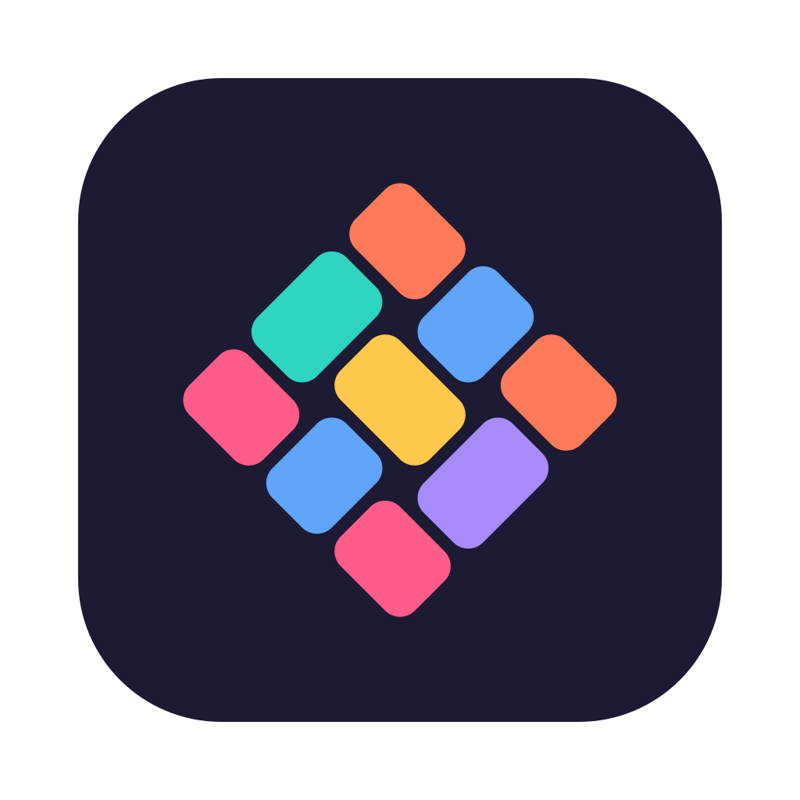
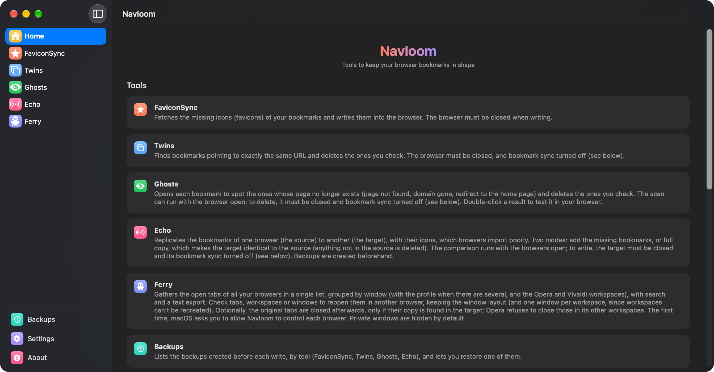
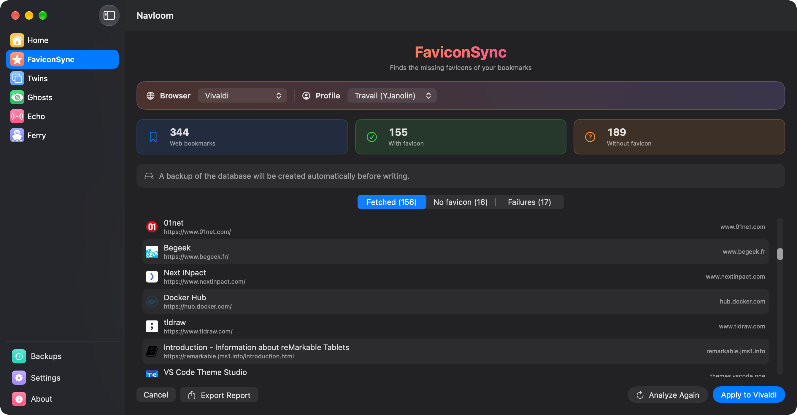
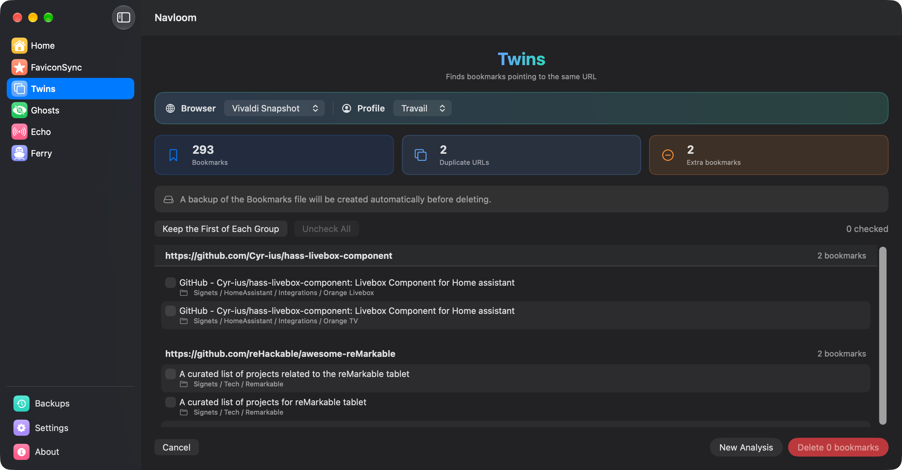
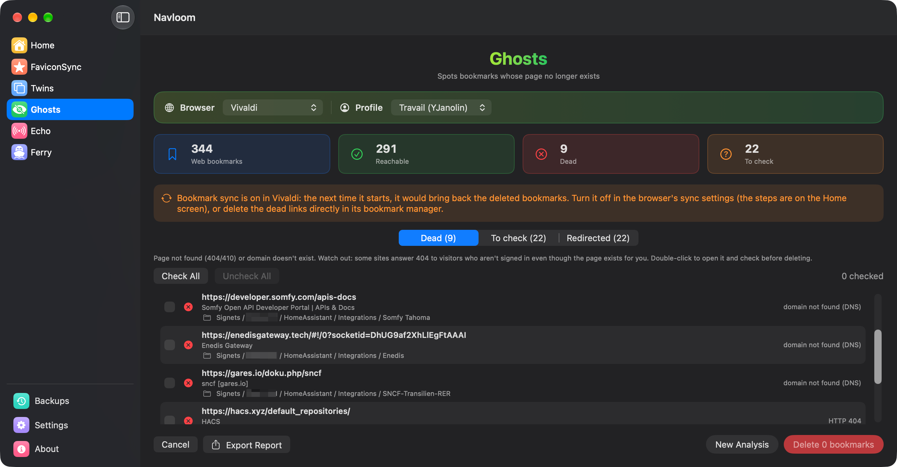
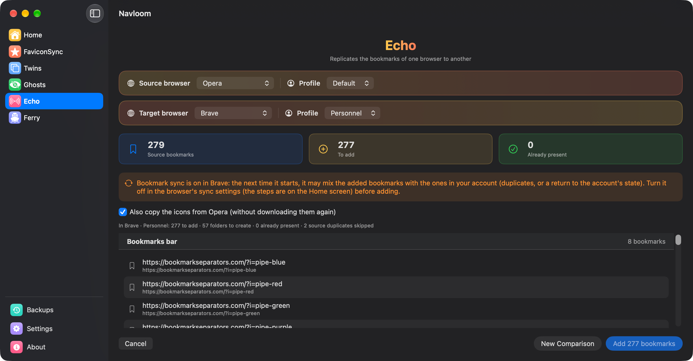
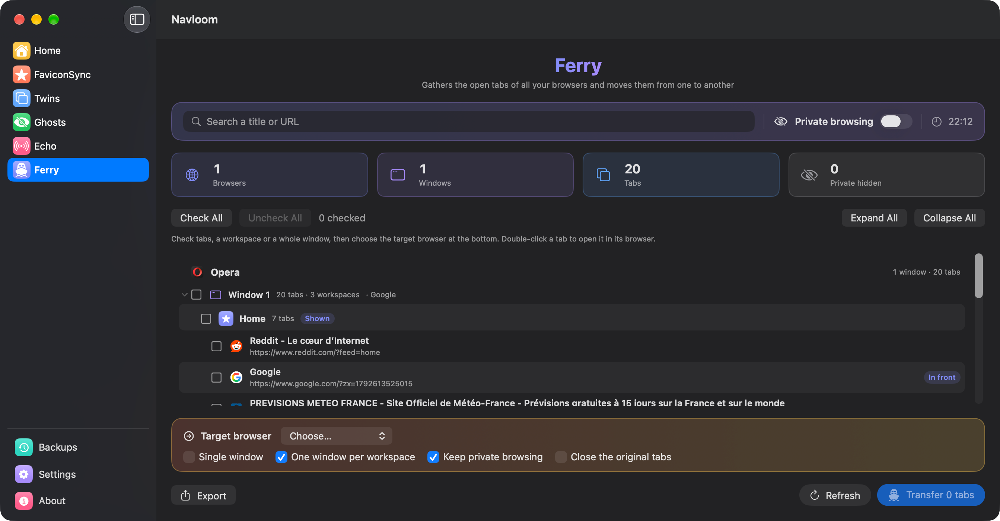
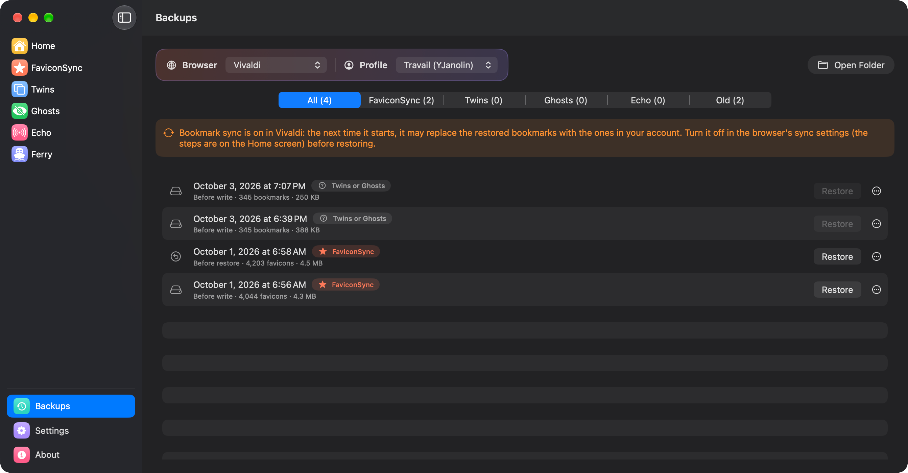

<p align="center">
  
</p>

<h1 align="center">Navloom</h1>

<p align="center">
  <a href="https://github.com/Yohan-Janolin/MacOS_Navloom/releases/latest"></a>
  
  
  <a href="LICENSE"></a>
</p>

<p align="center">
  <a href="README.md">🇬🇧 English</a> · 🇫🇷 Français
</p>

---

Navloom est une petite boîte à outils pour garder en forme les favoris et les onglets de tes navigateurs sur macOS.

Il récupère les favicons manquantes, repère les doublons et les liens morts, copie les favoris d'un navigateur à l'autre avec leurs icônes, et rassemble les onglets ouverts de tous tes navigateurs pour les faire passer de l'un à l'autre. Tout se passe sur ton Mac, dans une interface native, avec une sauvegarde avant chaque modification.

Navloom fonctionne avec les navigateurs basés sur Chromium (Chrome, Edge, Brave, Vivaldi, Opera…) et existe en français et en anglais.

## 📸 Captures d'écran

<p align="center">
  
</p>

| FaviconSync | Twins | Ghosts |
|:---:|:---:|:---:|
|  |  |  |
| **Echo** | **Ferry** | **Sauvegardes** |
|  |  |  |

## ✨ Fonctionnalités

### ⭐ FaviconSync : les favicons manquantes

Après un changement de navigateur, un import de favoris ou un bug, beaucoup de favoris se retrouvent sans icône. FaviconSync repère les favoris d'un profil qui n'en ont pas, récupère les icônes sur les sites (`favicon.ico`, puis les icônes déclarées dans la page) et les écrit dans la base d'icônes du navigateur.

- L'analyse ne modifie rien : tu vois les résultats avant d'écrire.
- Les résultats sont classés en trois onglets : **récupérées**, **sans favicon** (le site n'en a vraiment pas) et **échecs** (délai dépassé, erreur serveur…), avec le motif de chacun.
- Un rapport texte peut être exporté.
- **Limites :** le navigateur doit être complètement fermé (Cmd + Q) pour écrire. Certains sites ne sont pas accessibles sans être connecté, ou ne déclarent leur icône qu'en JavaScript ou en SVG : ceux-là restent sans icône. Les favoris qui pointent vers des appareils de ton réseau local demandent l'autorisation *Réseau local*.

### 🟦 Twins : les doublons

Twins regroupe les favoris qui pointent sur **exactement** la même URL et supprime les copies que tu coches.

- Une copie de chaque groupe reste toujours décochée : impossible de tout supprimer par erreur.
- Un raccourci garde le premier favori de chaque groupe et coche les autres.
- **Limites :** le navigateur doit être fermé et sa **synchro des favoris désactivée**, sinon il remettrait les favoris supprimés à son prochain lancement (la marche à suivre pour Vivaldi est dans l'écran Accueil de l'app). Les URL qui ne diffèrent que légèrement (`http`/`https`, `www`, `/` final) ne sont *pas* considérées comme des doublons.

### 👻 Ghosts : les liens morts

Ghosts ouvre chaque favori pour vérifier que sa page répond encore, et classe les problèmes en trois onglets :

- **Morts** : page introuvable (404/410) ou domaine qui n'existe plus ;
- **À vérifier** : délai dépassé, erreur serveur, certificat invalide… impossible de conclure ;
- **Redirigés** : la page mène maintenant vers un autre site ou vers la page d'accueil.

Double-clic sur un résultat pour l'ouvrir dans ton navigateur, puis supprime ceux que tu coches. Un rapport texte peut être exporté.

- **Limites :** la recherche peut se faire navigateur ouvert, mais la suppression demande qu'il soit fermé et sa synchro des favoris désactivée (comme pour Twins). Certains sites répondent « page introuvable » aux visiteurs non connectés alors que la page existe pour toi : vérifie toujours avant de supprimer.

### 📡 Echo : copier les favoris d'un navigateur à l'autre

Les navigateurs savent importer les favoris des autres, mais perdent ou abîment souvent leurs icônes. Echo réplique les favoris d'un navigateur **source** vers un navigateur **cible**, avec leurs icônes, sans les retélécharger.

- Mode **Ajouter les manquants** : la cible garde tous ses favoris ; seuls ceux qui lui manquent sont ajoutés, dans les mêmes dossiers.
- Mode **Copie complète** : la cible devient identique à la source (dossiers, ordre, noms) ; les favoris de la cible absents de la source sont supprimés.
- Options de comparaison : URL absente de toute la cible ou seulement du même dossier, et variantes d'URL à traiter comme identiques (`http`/`https`, `www`, paramètres `?…`).
- **Limites :** une source et une cible à la fois. La comparaison peut se faire navigateurs ouverts ; pour écrire, la cible doit être fermée et sa synchro des favoris désactivée. Les favoris non web (`vivaldi://`, `opera://`…) ne sont pas copiés.

### ⛴️ Ferry : les onglets ouverts

Ferry rassemble en une seule liste les onglets ouverts de tous tes navigateurs lancés, regroupés par navigateur, fenêtre, profil et espace de travail (Opera et Vivaldi), avec une recherche et un export texte.

- Coche des onglets, des espaces ou des fenêtres entières pour les rouvrir dans un autre navigateur, en gardant le découpage par fenêtre (ou dans une seule fenêtre).
- En option, les onglets d'origine sont fermés ensuite, **seulement** une fois leur copie retrouvée dans la cible.
- Les fenêtres de navigation privée sont masquées par défaut et peuvent être rouvertes en navigation privée.
- **Limites :** les espaces de travail ne peuvent pas être recréés dans la cible : chacun arrive dans sa propre fenêtre. Opera refuse de fermer les onglets d'un espace autre que celui affiché : ils sont copiés mais restent ouverts. La première fois, macOS te demande d'autoriser Navloom à contrôler chaque navigateur.

### 💾 Sauvegardes

Chaque écriture est précédée d'une sauvegarde du fichier qu'elle modifie (le fichier `Bookmarks` et/ou la base `Favicons`). L'écran **Sauvegardes** les liste par outil et restaure n'importe laquelle en un clic (l'état actuel est lui-même sauvegardé avant).

- Emplacement par défaut : `~/Library/Application Support/Navloom/Backups` (modifiable dans les Paramètres).
- Les anciennes sauvegardes peuvent être nettoyées automatiquement (par défaut, les 10 dernières « avant écriture » et les 5 dernières « avant restauration » sont conservées, par profil et par outil). Les sauvegardes en trop vont à la corbeille, elles ne sont pas supprimées définitivement.

## 🧩 Compatibilité

**macOS 14.6 (Sonoma) ou plus récent**, sur les Mac Apple Silicon et Intel.

| Navigateur | FaviconSync | Twins | Ghosts | Echo | Ferry |
|---|:---:|:---:|:---:|:---:|:---:|
| Google Chrome · Beta · Canary | ✅ | ✅ ¹ | ✅ ¹ | ✅ | ✅ |
| Microsoft Edge · Beta · Dev · Canary | ✅ | ✅ | ✅ | ✅ | ✅ |
| Brave · Beta · Nightly | ✅ | ✅ | ✅ | ✅ | ✅ |
| Vivaldi · Snapshot | ✅ | ✅ | ✅ | ✅ | ✅ ² |
| Opera · Developer · GX · Air | ✅ | ✅ | ✅ | ✅ | ✅ ² ³ |
| Chromium | ✅ ⁴ | ✅ ⁴ | ✅ ⁴ | ✅ ⁴ | ✅ |
| Arc | ❌ | ❌ | ❌ | ❌ | ❌ |
| Safari | ❌ | ❌ | ❌ | ❌ | ❌ |
| Firefox (et Zen, LibreWolf…) | ❌ | ❌ | ❌ | ❌ | ❌ |

1. Les favoris enregistrés **dans ton compte Google** sont affichés (avec une icône nuage) mais ne peuvent pas être supprimés depuis Navloom : Chrome les remettrait depuis ses serveurs. Supprime-les dans Chrome.
2. Les espaces de travail sont lus et affichés.
3. Les onglets d'un espace autre que celui affiché peuvent être copiés mais pas fermés (Opera refuse).
4. Chromium n'apparaît qu'une fois qu'il a au moins un favori (avant, il n'a pas de fichier de favoris).

**Non compatibles :** Arc (il ne range pas ses favoris dans le même format et ne relit pas les icônes posées de l'extérieur), Safari et les navigateurs basés sur Firefox (formats de favoris différents).

## 🔐 Autorisations nécessaires

| Autorisation | Pourquoi | Quand |
|---|---|---|
| **Accès complet au disque** | Sur les versions récentes de macOS, Chrome, Edge et Brave (versions stables) protègent leur dossier de données. Sans cet accès, ils n'apparaissent pas dans Navloom. Les autres navigateurs n'en ont pas besoin. | Au premier lancement, si l'un de ces navigateurs est installé. Navloom explique comment l'accorder. |
| **Automatisation** (contrôle de chaque navigateur) | Ferry lit les onglets ouverts et en ouvre de nouveaux via AppleScript. | La première fois que Ferry lit ou ouvre des onglets dans un navigateur donné. |
| **Réseau local** | FaviconSync et Ghosts en ont besoin pour joindre les favoris qui pointent vers des appareils de ton réseau (box, NAS…). | Quand un tel favori est vérifié. |

Pour accorder l'Accès complet au disque : **Réglages Système › Confidentialité et sécurité › Accès complet au disque**, ajoute Navloom avec le bouton **+**, active-le, puis relance Navloom.

## 🔒 Confidentialité

Navloom ne collecte rien et n'envoie rien à ton sujet. Pas de compte, pas de statistiques, pas de pistage. Les seules requêtes réseau sont celles de FaviconSync et Ghosts, envoyées directement aux sites de tes propres favoris pour récupérer leurs icônes ou vérifier qu'ils répondent. Navloom ne lit que tes favoris, tes icônes et quelques réglages des navigateurs (noms de profils, état de la synchro).

## 📥 Installation

1. Télécharge `Navloom-x.y.z.dmg` depuis la [dernière version](https://github.com/Yohan-Janolin/MacOS_Navloom/releases/latest).
2. Ouvre-le et fais glisser **Navloom** sur le dossier **Applications**.
3. Lance Navloom depuis ton dossier Applications.

> [!WARNING]
> **Navloom n'est pas notarisé par Apple.** Il est signé avec le certificat personnel de l'auteur, et non avec un compte développeur Apple payant : macOS le bloque donc à la première ouverture. C'est normal, il suffit de l'autoriser une fois :
>
> 1. Ouvre Navloom : macOS indique qu'il ne peut pas le vérifier. Clique sur **Terminé**.
> 2. Ouvre **Réglages Système › Confidentialité et sécurité** et descends jusqu'à la section **Sécurité**.
> 3. À côté du message concernant Navloom, clique sur **Ouvrir quand même**, puis confirme avec ton mot de passe.
>
> Sous macOS 14 (Sonoma), tu peux aussi faire un Ctrl-clic sur l'app et choisir **Ouvrir**.
>
> Si tu préfères le Terminal : `xattr -dr com.apple.quarantine /Applications/Navloom.app`
>
> Tu peux vérifier que le téléchargement est authentique en comparant son empreinte SHA-256 (`shasum -a 256 Navloom-x.y.z.dmg`) à celle indiquée dans les notes de version.

## 🔄 Mise à jour

Les mises à jour automatiques arriveront dans une prochaine version. En attendant, télécharge le nouveau DMG depuis la [page des versions](https://github.com/Yohan-Janolin/MacOS_Navloom/releases) et remplace l'app dans ton dossier Applications.

Tes autorisations (Accès complet au disque, Automatisation) sont conservées d'une version à l'autre, car chaque version est signée avec le même certificat. Tes réglages et tes sauvegardes aussi.

## 📝 Historique des versions

### 0.1.0
- Première version publique : FaviconSync, Twins, Ghosts, Echo et Ferry, sauvegardes et restauration, français et anglais.

## 🛠️ Compiler depuis les sources

Prérequis : une version récente de Xcode (le projet utilise le format de Xcode 27) et macOS 14.6 ou plus récent.

```bash
git clone https://github.com/Yohan-Janolin/MacOS_Navloom.git
cd MacOS_Navloom
open Navloom.xcodeproj
```

Choisis le schéma **Navloom** et **My Mac**, puis **Product › Run** (⌘R). Les tests se lancent avec **Product › Test** (⌘U).

Le projet est signé avec le certificat de l'auteur, que tu n'as pas : dans les **Build Settings** de la cible, mets **Code Signing Identity** sur **Sign to Run Locally** (ou sur ton propre certificat).

Pour fabriquer un DMG comme ceux publiés, `scripts/make-dmg.sh` archive l'app, vérifie sa signature et crée l'image disque. Il demande [create-dmg](https://github.com/create-dmg/create-dmg) (`brew install create-dmg`) et un certificat de signature, dont le nom se règle en haut du script.

## 🤝 Contribuer et signaler un problème

Les signalements de bugs, les idées et les pull requests sont les bienvenus !

- **Un bug ?** [Ouvre une issue](https://github.com/Yohan-Janolin/MacOS_Navloom/issues/new) en indiquant ta version de macOS, le navigateur concerné, ce que tu as fait et ce qui s'est passé. Un rapport exporté ou une capture d'écran aident beaucoup.
- **Une idée, un navigateur à prendre en charge ?** Ouvre une issue pour en discuter d'abord.
- **Une pull request ?** Limite-la à un seul changement, vérifie que les tests passent (⌘U), et ajoute la traduction française de tout nouveau texte dans `Localizable.xcstrings`.

## ⚠️ Avertissement

Navloom modifie les fichiers de tes navigateurs. Il crée toujours une sauvegarde avant d'écrire, et il a été conçu et testé avec soin, mais il est fourni **« tel quel », sans aucune garantie**. L'auteur ne peut pas être tenu responsable d'une perte de données ou de tout autre dégât. Tu l'utilises à tes risques, et garde tes propres sauvegardes de ce qui compte pour toi.

Navloom n'est affilié ni à Google, ni à Microsoft, ni à Brave, Vivaldi, Opera ou tout autre éditeur de navigateur. Leurs noms ne sont cités que pour décrire la compatibilité.

## 📄 Licence

Navloom est distribué sous [licence MIT](LICENSE).
